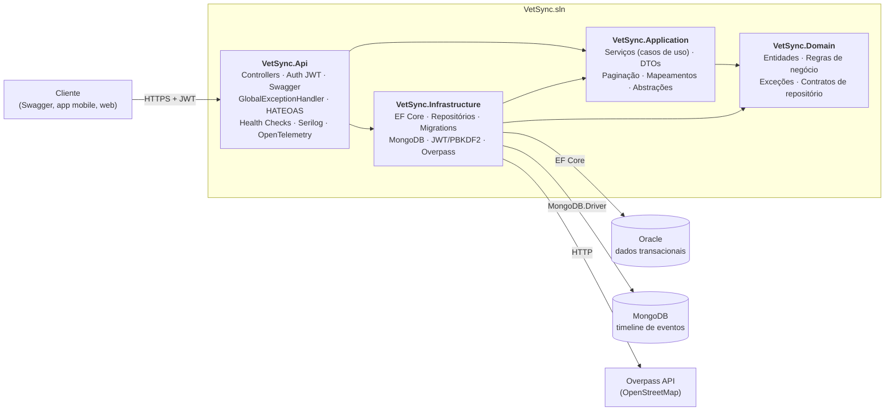

# VetSync API — FIAP Challenge · Sprint 4 (Advanced Business Development with .NET)

API RESTful da **jornada contínua de cuidado do pet** (Clyvo Vet): tutores, pets, consultas, vacinações e
exames, com busca de clínicas veterinárias reais por geolocalização (OpenStreetMap). Desenvolvida com
**ASP.NET Core 8**, **Clean Architecture**, **Oracle (EF Core)** para dados transacionais e **MongoDB** para a
linha do tempo de eventos do pet.

## Equipe

| Nome | RM |
|------|----|
| Arthur Brito | RM 562085 |
| Luiz Felipe Flosi | RM 563197 |
| Pedro Brum | RM 561780 |

---

## Sumário

1. [Visão geral e o que mudou na Sprint 4](#1-visão-geral-e-o-que-mudou-na-sprint-4)
2. [Arquitetura](#2-arquitetura)
3. [Tecnologias](#3-tecnologias)
4. [Como executar](#4-como-executar)
5. [Autenticação e autorização (JWT)](#5-autenticação-e-autorização-jwt)
6. [Endpoints](#6-endpoints)
7. [Paginação, ordenação e filtros](#7-paginação-ordenação-e-filtros)
8. [HATEOAS](#8-hateoas)
9. [Tratamento de erros](#9-tratamento-de-erros)
10. [Persistência: Oracle + MongoDB](#10-persistência-oracle--mongodb)
11. [Monitoramento e observabilidade](#11-monitoramento-e-observabilidade)
12. [Testes automatizados](#12-testes-automatizados)
13. [Estrutura do projeto](#13-estrutura-do-projeto)
14. [Migrations (EF Core)](#14-migrations-ef-core)
15. [Docker](#15-docker)
16. [Documentação Swagger / OpenAPI](#16-documentação-swagger--openapi)
17. [Mudanças em relação à Sprint 3](#17-mudanças-em-relação-à-sprint-3)

---

## 1. Visão geral e o que mudou na Sprint 4

Checklist dos requisitos da Sprint 4 e onde cada um está no código:

| # | Requisito | Onde está |
|---|-----------|-----------|
| 1 | Clean Architecture com separação de camadas | `src/VetSync.Domain`, `Application`, `Infrastructure`, `Api` ([seção 2](#2-arquitetura)) |
| 1 | SOLID / Clean Code | Controllers finos, serviços com uma responsabilidade, regras de negócio nas entidades, dependências por interface |
| 1 | Injeção de dependência | `AddApplication()` e `AddInfrastructure()` (um método de registro por camada) |
| 1 | Tratamento de exceções global e consistente | `GlobalExceptionHandler` (`IExceptionHandler`) → respostas RFC 7807 ([seção 9](#9-tratamento-de-erros)) |
| 2 | Swagger/OpenAPI atualizado | `/` (Swagger UI) e `/swagger/v1/swagger.json`, com botão **Authorize** (JWT) |
| 2 | Paginação, ordenação e filtros | Todas as coleções ([seção 7](#7-paginação-ordenação-e-filtros)) |
| 2 | HATEOAS nos endpoints de consulta | Campo `links` em itens e páginas ([seção 8](#8-hateoas)) |
| 2 | Autenticação e autorização JWT | `/api/auth/*`, `[Authorize]`, perfis `Admin` e `Usuario` ([seção 5](#5-autenticação-e-autorização-jwt)) |
| 3 | EF Core com migrations (Oracle) | `src/VetSync.Infrastructure/Persistence/Migrations` |
| 3 | MongoDB para operações NoSQL | Linha do tempo do pet: `GET /api/pets/{id}/timeline` ([seção 10](#10-persistência-oracle--mongodb)) |
| 3 | Repositórios concretos (padrão Repository) | `Infrastructure/Persistence/Repositories` + interfaces em `Domain/Repositories` |
| 4 | Health Checks | `/health`, `/health/live`, `/health/ready` (API, Oracle, MongoDB, Overpass) |
| 4 | Logging estruturado | Serilog (console + arquivo) com `CorrelationId` por requisição |
| 4 | Testes unitários e de integração (AAA, xUnit) | `tests/VetSync.Tests.Unit` e `tests/VetSync.Tests.Integration` |
| 4 | Cobertura das camadas Domain e Application | Testes de entidades, paginação e de **todos** os serviços de aplicação |
| 5 | README completo, diagrama e endpoints | Este arquivo |

---

## 2. Arquitetura

### Diagrama da solução



### Regra de dependência

As dependências apontam sempre **para dentro** (em direção ao Domain):

| Camada | Referencia | Responsabilidade |
|--------|-----------|------------------|
| **Domain** | nada | Entidades com comportamento (`Consulta.Atualizar`, `Vacinacao.Validar`, `Pet.CalcularIdadeEmAnos`…), exceções de domínio, interfaces de repositório (`IPetRepository`…), filtros e `PageRequest`. |
| **Application** | Domain | Casos de uso (`PetService`, `ConsultaService`, `AuthService`…), DTOs, paginação (`PageQuery`/`PagedResult`), mapeamentos e abstrações (`IPasswordHasher`, `ITokenGenerator`, `IGeoLocationService`…). |
| **Infrastructure** | Application, Domain | Implementações: EF Core (`AppDbContext`, configurações Fluent, repositórios, migrations), MongoDB, JWT, hash de senha PBKDF2, cliente Overpass. |
| **Api** | Application, Infrastructure | *Composition root*: controllers, middleware, autenticação, Swagger, health checks, observabilidade. |

### Princípios SOLID aplicados

- **S** – cada serviço cuida de um agregado; controllers só traduzem HTTP ⇄ casos de uso.
- **O** – novos filtros/ordenações entram em `Filters.cs`/repositórios sem alterar serviços existentes.
- **L** – todos os repositórios EF herdam de `EfRepository<T>` respeitando o contrato `IRepository<T>`.
- **I** – interfaces pequenas e específicas (`IPasswordHasher`, `ITokenGenerator`, `IJornadaEventPublisher`…).
- **D** – serviços dependem de abstrações; as implementações são ligadas em `DependencyInjection.cs`.

### Fluxo de uma requisição

```
HTTP → CorrelationId → ExceptionHandler → Serilog request log → Authentication/Authorization
     → Controller → Service (Application) → Repository (Infrastructure) → Oracle
                                          └→ JornadaEventPublisher → MongoDB (best effort)
```

---

## 3. Tecnologias

- ASP.NET Core 8 (Controllers) · Swagger/OpenAPI (Swashbuckle)
- Entity Framework Core 8 + Oracle.EntityFrameworkCore (Fluent API + migrations)
- MongoDB 7 + MongoDB.Driver
- Autenticação JWT Bearer (`Microsoft.AspNetCore.Authentication.JwtBearer`) e PBKDF2-SHA256 para senhas
- Serilog (console + arquivo), Health Checks, OpenTelemetry (tracing + métricas Prometheus)
- Overpass API (OpenStreetMap) para clínicas reais, sem chave de API
- xUnit · Moq · FluentAssertions · `WebApplicationFactory` · EF Core InMemory · coverlet

---

## 4. Como executar

### Pré-requisitos

- .NET 8 SDK
- Oracle XE e MongoDB (o jeito mais simples é `docker compose up`, ver [seção 15](#15-docker))

### Execução local

```bash
git clone https://github.com/Challenge-2TDSPG-2026/vetSync-Dotnet.git
cd vetSync-Dotnet

# 1) Bancos (Oracle + MongoDB) em containers
docker compose up -d oracle mongo

# 2) API (as migrations são aplicadas automaticamente na inicialização)
dotnet run --project src/VetSync.Api
```

- Swagger UI: <http://localhost:5000>
- Busca de clínicas (demo): <http://localhost:5000/buscar-clinicas.html>
- Health: <http://localhost:5000/health>

### Configuração (`src/VetSync.Api/appsettings*.json` ou variáveis de ambiente)

| Chave | Variável de ambiente | Descrição |
|-------|----------------------|-----------|
| `ConnectionStrings:OracleConnection` | `ConnectionStrings__OracleConnection` | Conexão Oracle |
| `Mongo:ConnectionString` / `Mongo:Database` | `Mongo__ConnectionString` / `Mongo__Database` | Conexão MongoDB |
| `Jwt:Key` | `Jwt__Key` | **Obrigatória**, mínimo 32 caracteres. A API não sobe sem ela. |
| `Jwt:Issuer`, `Jwt:Audience`, `Jwt:ExpirationMinutes` | `Jwt__...` | Emissor, audiência e validade do token (padrão 60 min) |
| `Seed:AdminEmail` / `Seed:AdminPassword` | `Seed__...` | Se informados, cria o usuário **Admin** inicial na primeira execução |

Em `Development`, `appsettings.Development.json` traz uma chave JWT de desenvolvimento e o admin
`admin@vetsync.com` / `Admin@123`. **Em qualquer outro ambiente informe `Jwt__Key` por variável de
ambiente ou user-secrets** (`dotnet user-secrets set "Jwt:Key" "<chave>" --project src/VetSync.Api`).

---

## 5. Autenticação e autorização (JWT)

| Perfil | Permissões |
|--------|-----------|
| *(anônimo)* | `POST /api/auth/register`, `POST /api/auth/login`, `GET /api/clinicas/proximas`, `/health*` |
| `Usuario` | Leitura, criação e atualização de tutores, pets, consultas, vacinações e exames |
| `Admin` | Tudo o que `Usuario` faz **+** `DELETE` em todos os recursos |

Fluxo:

```bash
# 1) cadastro (perfil Usuario) — já devolve token
curl -X POST http://localhost:5000/api/auth/register -H "Content-Type: application/json" \
  -d '{"nome":"Maria Souza","email":"maria@vetsync.com","senha":"Senha@123"}'

# 2) login
curl -X POST http://localhost:5000/api/auth/login -H "Content-Type: application/json" \
  -d '{"email":"admin@vetsync.com","senha":"Admin@123"}'

# 3) usar o token
curl http://localhost:5000/api/pets -H "Authorization: Bearer <token>"
```

Regras: senha com **mínimo de 8 caracteres, com letras e números**; e-mails são únicos; senhas são
armazenadas com **PBKDF2-HMAC-SHA256** (100 mil iterações, salt aleatório) — nunca em texto puro.
Sem token ou token inválido → `401`; perfil sem permissão → `403`.

---

## 6. Endpoints

Todas as rotas abaixo (exceto as marcadas como públicas) exigem `Authorization: Bearer <token>`.

| Recurso | Método e rota | Descrição | Acesso |
|---------|---------------|-----------|--------|
| **Auth** | `POST /api/auth/register` | Cria conta e devolve token | público |
| | `POST /api/auth/login` | Autentica e devolve token | público |
| **Tutores** | `GET /api/tutores` | Lista paginada (filtros: `nome`, `email`, `ativo`) | autenticado |
| | `GET /api/tutores/{id}` | Busca por ID | autenticado |
| | `POST /api/tutores` | Cadastra | autenticado |
| | `PUT /api/tutores/{id}` | Atualiza | autenticado |
| | `DELETE /api/tutores/{id}` | Remove (409 se tiver pets) | **Admin** |
| **Pets** | `GET /api/pets` | Lista paginada (filtros: `nome`, `especie`, `raca`, `ativo`, `tutorId`) | autenticado |
| | `GET /api/pets/{id}` | Busca por ID | autenticado |
| | `GET /api/pets/{id}/jornada` | Consultas, vacinas e exames (Oracle) | autenticado |
| | `GET /api/pets/{id}/timeline?limite=50` | Linha do tempo de eventos (**MongoDB**) | autenticado |
| | `POST /api/pets` · `PUT /api/pets/{id}` | Cadastra / atualiza | autenticado |
| | `DELETE /api/pets/{id}` | Remove | **Admin** |
| **Consultas** | `GET /api/consultas` | Lista paginada (filtros: `petId`, `status`, `de`, `ate`) | autenticado |
| | `GET /api/consultas/{id}` · `POST` · `PUT /{id}` | Consulta / agenda / atualiza status | autenticado |
| | `DELETE /api/consultas/{id}` | Remove | **Admin** |
| **Vacinações** | `GET /api/vacinacoes` | Lista paginada (filtros: `petId`, `proximaDoseAte`) | autenticado |
| | `GET /api/vacinacoes/{id}` · `POST` | Consulta / registra | autenticado |
| | `DELETE /api/vacinacoes/{id}` | Remove | **Admin** |
| **Exames** | `GET /api/exames` | Lista paginada (filtros: `petId`, `tipo`) | autenticado |
| | `GET /api/exames/{id}` · `POST` · `PUT /{id}` | Consulta / registra / lança resultado | autenticado |
| | `DELETE /api/exames/{id}` | Remove | **Admin** |
| **Clínicas** | `GET /api/clinicas/proximas?latitude=&longitude=&raioKm=` | Clínicas reais próximas (OpenStreetMap, raio máx. 50 km) | público |

Os status HTTP possíveis de cada rota (200, 201, 204, 400, 401, 403, 404, 409, 503) estão no Swagger.

Status válidos de consulta: `Agendada`, `Em andamento`, `Realizada`, `Cancelada`.

---

## 7. Paginação, ordenação e filtros

Todas as coleções aceitam:

| Parâmetro | Padrão | Descrição |
|-----------|--------|-----------|
| `page` | `1` | Página (começa em 1) |
| `pageSize` | `10` | Itens por página (máximo **100**) |
| `sortBy` | varia | Campo de ordenação (valores aceitos abaixo) |
| `sortDir` | `asc` | `asc` ou `desc` |

| Recurso | `sortBy` aceitos | Ordenação padrão |
|---------|------------------|------------------|
| tutores | `id`, `nome`, `email`, `criadoEm` | `nome` asc |
| pets | `id`, `nome`, `especie`, `raca`, `criadoEm` | `nome` asc |
| consultas | `id`, `dataConsulta`, `status`, `veterinario` | `dataConsulta` desc |
| vacinacoes | `id`, `dataAplicacao`, `proximaDose`, `vacina` | `dataAplicacao` desc |
| exames | `id`, `dataExame`, `tipoExame` | `dataExame` desc |

`sortBy`/`sortDir` inválidos retornam `400`. A ordenação inclui o `Id` como desempate, garantindo
paginação estável.

Exemplo — pets de cães do tutor 7, página 2, ordenados por nome decrescente:

```
GET /api/pets?tutorId=7&especie=cão&page=2&pageSize=5&sortBy=nome&sortDir=desc
```

Resposta (resumida):

```json
{
  "items": [ { "id": 12, "nome": "Thor", "links": [ ... ] } ],
  "page": 2,
  "pageSize": 5,
  "totalCount": 9,
  "totalPages": 2,
  "hasPrevious": true,
  "hasNext": false,
  "links": [
    { "href": "/api/pets?tutorId=7&especie=c%C3%A3o&sortBy=nome&sortDir=desc&page=2&pageSize=5", "rel": "self",  "method": "GET" },
    { "href": "/api/pets?tutorId=7&...&page=1&pageSize=5", "rel": "first", "method": "GET" },
    { "href": "/api/pets?tutorId=7&...&page=1&pageSize=5", "rel": "prev",  "method": "GET" },
    { "href": "/api/pets?tutorId=7&...&page=2&pageSize=5", "rel": "last",  "method": "GET" }
  ]
}
```

---

## 8. HATEOAS

Todo recurso retornado por endpoints de consulta (`GET` por id, `GET` de coleção, e o retorno dos
`POST`) traz o campo `links` com as ações disponíveis, e as coleções paginadas trazem os links de
navegação `self / first / prev / next / last`.

```json
{
  "id": 3,
  "nome": "Thor",
  "tutorId": 7,
  "links": [
    { "href": "/api/pets/3",                 "rel": "self",       "method": "GET" },
    { "href": "/api/pets/3",                 "rel": "update",     "method": "PUT" },
    { "href": "/api/pets/3",                 "rel": "delete",     "method": "DELETE" },
    { "href": "/api/tutores/7",              "rel": "tutor",      "method": "GET" },
    { "href": "/api/pets/3/jornada",         "rel": "jornada",    "method": "GET" },
    { "href": "/api/pets/3/timeline",        "rel": "timeline",   "method": "GET" },
    { "href": "/api/consultas?petId=3",      "rel": "consultas",  "method": "GET" },
    { "href": "/api/vacinacoes?petId=3",     "rel": "vacinacoes", "method": "GET" },
    { "href": "/api/exames?petId=3",         "rel": "exames",     "method": "GET" }
  ]
}
```

A montagem dos links fica centralizada em `src/VetSync.Api/Hateoas/ResourceLinks.cs`.

---

## 9. Tratamento de erros

Um único `GlobalExceptionHandler` converte exceções em **ProblemDetails (RFC 7807)**, sem vazar
detalhes internos em erros 500 e incluindo `traceId` e `correlationId`:

| Exceção | HTTP | Exemplo |
|---------|------|---------|
| `NotFoundException` | 404 | Pet com ID 99 não encontrado |
| `BusinessRuleException` | 400 | Status inválido; próxima dose anterior à aplicação; ordenação inválida |
| `ConflictException` | 409 | E-mail duplicado; tutor com pets |
| `AuthenticationFailedException` | 401 | E-mail ou senha inválidos |
| `VeterinaryClinicSearchException` | 503 | Overpass API fora do ar |
| validação de DTO (`[ApiController]`) | 400 | Campos obrigatórios/inválidos |
| qualquer outra | 500 | Mensagem genérica + `correlationId` |

```json
{
  "status": 404,
  "title": "Recurso não encontrado",
  "detail": "Pet com ID 99 não encontrado(a).",
  "instance": "/api/pets/99",
  "traceId": "0HN...",
  "correlationId": "5f1c0c9e0f0b4a3f9e1f3f7f8a2a1b11"
}
```

---

## 10. Persistência: Oracle + MongoDB

### Oracle (relacional) — EF Core + padrão Repository

- Mapeamento por **Fluent API** (`Persistence/Configurations`): o Domain não tem atributos de persistência.
- `IRepository<T>` + repositórios concretos por agregado (`TutorRepository`, `PetRepository`, …) e
  `IUnitOfWork` para confirmar a transação.
- Tabelas: `TUTORES`, `PETS`, `CONSULTAS`, `VACINACOES`, `EXAMES`, `USUARIOS`.
- Migrations aplicadas automaticamente na inicialização (com retentativas enquanto o Oracle sobe).

### MongoDB (NoSQL) — linha do tempo do pet

Cada operação relevante grava um documento `JornadaEvento` na coleção `jornada_eventos`
(`ConsultaAgendada`, `ConsultaAtualizada`, `VacinaAplicada`, `ExameRegistrado`, `ExameAtualizado`).
É um *read model* denormalizado (nome do pet, descrição e detalhes ficam no próprio documento),
consultado por `GET /api/pets/{id}/timeline` sem JOINs. Há índice composto `(PetId, OcorridoEm desc)`.

A gravação no Mongo é **best effort**: se o MongoDB estiver fora do ar, o erro é registrado em log e a
operação principal no Oracle continua funcionando (o health check `mongodb` fica `Degraded`).

---

## 11. Monitoramento e observabilidade

### Health Checks

| Endpoint | Finalidade |
|----------|------------|
| `GET /health` | Status geral em JSON detalhado (nome, status, duração e erro de cada verificação) |
| `GET /health/live` | Liveness — o processo está de pé |
| `GET /health/ready` | Readiness — dependências disponíveis |

| Verificação | O que checa | Se falhar |
|-------------|-------------|-----------|
| `self` | Processo da API | Unhealthy |
| `oracle-database` | Conectividade real com o Oracle (EF Core) | Unhealthy |
| `mongodb` | Ping no MongoDB | Degraded |
| `overpass-api` | Disponibilidade da Overpass API | Degraded |

### Logging estruturado (Serilog)

Níveis `Information`, `Warning` e `Error`, saída em console e em arquivo (`logs/vetsync-.log`, rotação
diária, 14 dias). Todo log carrega o `CorrelationId` (header `X-Correlation-ID`, gerado se ausente e
devolvido na resposta).

### Tracing e métricas (OpenTelemetry)

Tracing de ASP.NET Core, HttpClient e EF Core (exportador console). Métricas de tempo de resposta,
taxa de erros e runtime em `GET /metrics` (formato Prometheus).

---

## 12. Testes automatizados

Padrão **AAA** (Arrange / Act / Assert), nomenclatura `MetodoTestado_Cenario_ResultadoEsperado`.

| Projeto | O que cobre |
|---------|-------------|
| `tests/VetSync.Tests.Unit/Domain` | Regras das entidades (`Pet`, `Consulta`, `Vacinacao`, `Exame`, `Usuario`) e `PageRequest` |
| `tests/VetSync.Tests.Unit/Application` | Todos os serviços (`Tutor`, `Pet`, `Consulta`, `Vacinacao`, `Exame`, `Auth`, `Clinica`), `PageQuery`, `PagedResult`, publicador de eventos e mapeamentos — repositórios isolados com **Moq** |
| `tests/VetSync.Tests.Unit/Infrastructure` | Geolocalização, cliente Overpass e health check (HTTP simulado) |
| `tests/VetSync.Tests.Integration` | A API real via `WebApplicationFactory`: autenticação JWT, autorização por perfil, CRUD, paginação/ordenação/filtros, HATEOAS, ProblemDetails, timeline e health checks |

Nos testes de integração, o Oracle é trocado por **EF Core InMemory**, o MongoDB por um repositório em
memória e a busca de clínicas por um fake — assim a suíte roda **offline e de forma determinística**. A
instância da API é compartilhada por uma **Collection Fixture** (`IntegrationTestCollection`).

```bash
dotnet test                                   # tudo
dotnet test tests/VetSync.Tests.Unit          # só unitários
dotnet test tests/VetSync.Tests.Integration   # só integração
dotnet test --collect:"XPlat Code Coverage"   # com cobertura (coverlet)
```

---

## 13. Estrutura do projeto

```
VetSync.sln
├── Dockerfile · docker-compose.yml · entrypoint.sh
├── src/
│   ├── VetSync.Domain/
│   │   ├── Entities/            Tutor, Pet, Consulta, Vacinacao, Exame, Usuario, Roles
│   │   ├── Documents/           JornadaEvento (documento MongoDB)
│   │   ├── Exceptions/          NotFound, Conflict, BusinessRule, AuthenticationFailed
│   │   └── Repositories/        IRepository<T>, interfaces por agregado, filtros, PageRequest
│   ├── VetSync.Application/
│   │   ├── Services/            TutorService, PetService, ConsultaService, ... AuthService
│   │   ├── DTOs/                DTOs de entrada/saída e *Query (filtros)
│   │   ├── Common/              PageQuery, PagedResult, LinkDto (HATEOAS)
│   │   ├── Mappings/            Entidade <-> DTO
│   │   ├── Abstractions/        IPasswordHasher, ITokenGenerator, IGeoLocationService, ...
│   │   └── DependencyInjection.cs
│   ├── VetSync.Infrastructure/
│   │   ├── Persistence/         AppDbContext, Configurations/, Repositories/, Migrations/
│   │   ├── Mongo/               Repositório de eventos, health check, settings
│   │   ├── Security/            JwtTokenGenerator, Pbkdf2PasswordHasher, JwtSettings
│   │   ├── Services/            GeoLocationService, Overpass (+ Health/)
│   │   └── DependencyInjection.cs
│   └── VetSync.Api/
│       ├── Controllers/         Auth, Tutores, Pets, Consultas, Vacinacoes, Exames, Clinicas
│       ├── Hateoas/             ResourceLinks
│       ├── Middleware/          CorrelationId, GlobalExceptionHandler
│       ├── Extensions/          JWT, Swagger, Health Checks, OpenTelemetry
│       ├── wwwroot/             Página de demonstração das clínicas
│       └── Program.cs
└── tests/
    ├── VetSync.Tests.Unit/      Domain · Application · Infrastructure
    └── VetSync.Tests.Integration/  Fixtures · Tests
```

---

## 14. Migrations (EF Core)

As migrations ficam em `Infrastructure` e o projeto de inicialização é a `Api`:

```bash
dotnet tool install --global dotnet-ef

# criar nova migration
dotnet ef migrations add NomeDaMigration \
  --project src/VetSync.Infrastructure --startup-project src/VetSync.Api \
  --output-dir Persistence/Migrations

# aplicar manualmente (a API também aplica ao iniciar)
dotnet ef database update --project src/VetSync.Infrastructure --startup-project src/VetSync.Api
```

Migrations existentes: `InitialCreate` (tutores, pets, consultas, vacinações, exames) e `AddUsuarios`
(autenticação JWT).

---

## 15. Docker

```bash
docker compose up --build
```

Sobe **Oracle XE**, **MongoDB** e a **API** (`http://localhost:8080`). A API só inicia depois que os dois
bancos estiverem saudáveis. O container da API **não roda como root**.

```bash
docker compose down        # para tudo
docker compose down -v     # para e apaga os volumes (reset completo dos bancos)
```

---

## 16. Documentação Swagger / OpenAPI

- Swagger UI na raiz: `http://localhost:5000` (local) ou `http://localhost:8080` (Docker)
- Especificação exportável: `/swagger/v1/swagger.json`
- Para testar rotas protegidas: faça `POST /api/auth/login`, clique em **Authorize** e cole o token.

---

## 17. Mudanças em relação à Sprint 3

Para atender à paginação/filtros e à autenticação, o contrato da API mudou:

- Todas as rotas de recursos agora exigem **JWT** (exceto `auth`, `clinicas/proximas` e `health`).
- `GET` de coleções devolve um **objeto paginado** (`items`, `page`, `totalCount`, `links`…) em vez de um array.
- Rotas especializadas foram unificadas como **filtros** da coleção:
  `/api/pets/especie/{x}` → `/api/pets?especie=x` · `/api/consultas/pet/{id}` → `/api/consultas?petId=id` ·
  `/api/consultas/status/{s}` → `/api/consultas?status=s` · `/api/tutores/{id}/pets` → `/api/pets?tutorId=id`.
- `DELETE` passou a exigir perfil **Admin**.
- Erros agora seguem **ProblemDetails** (antes `{ "message": ... }`); e-mail duplicado retorna `409` (antes `400`).
- Corrigido: a migration `InitialCreate` não tinha os atributos `[DbContext]/[Migration]` e não era
  descoberta pelo EF Core; o AutoMapper foi substituído por mapeamentos explícitos.
